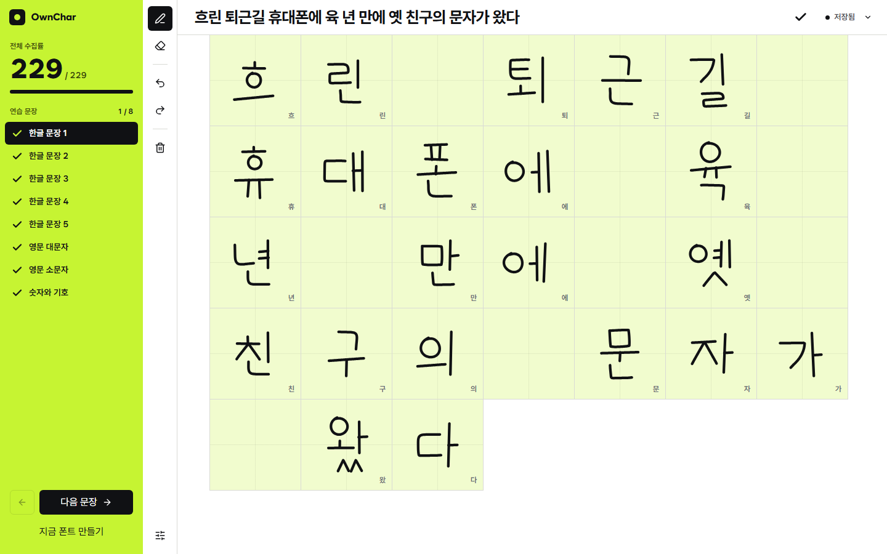
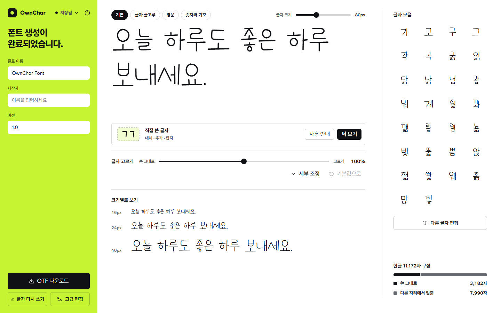
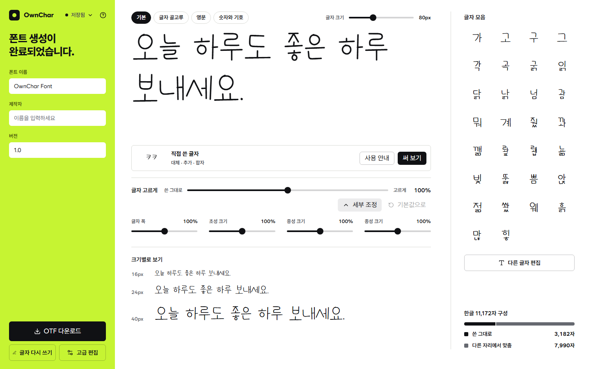
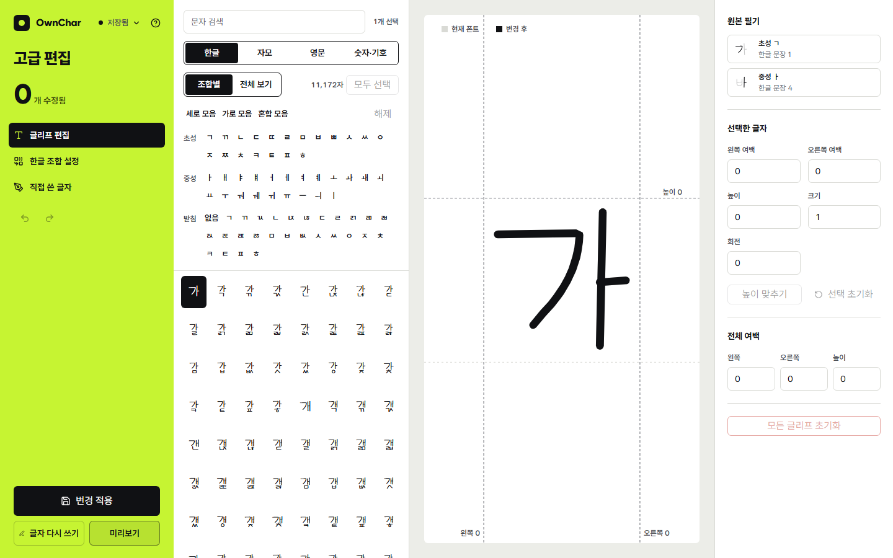
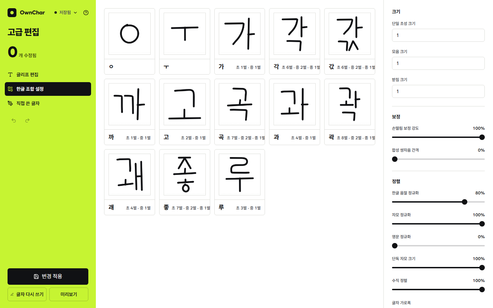

<div align="center">


# OwnChar

**문장 8개로 나만의 손글씨 폰트를 만드세요.**

브라우저에서 문장을 손으로 쓰면 자모를 나눠 모으고, 현대 한글 11,172자와 영문·숫자·기호를 조합해 OTF 폰트로 만드는 도구입니다.

**[ownchar.mokaayumu.com](https://ownchar.mokaayumu.com/)**


</div>

## 주요 기능

### 문장 8개만 쓰면 됩니다

한글 문장 5개, 영문 대문자, 영문 소문자, 숫자와 기호를 칸마다 한 글자씩 씁니다. 필압은 획 굵기로 반영되고, 손떨림 보정과 실행 취소·다시 실행(50단계)을 지원합니다. 자모가 잘못 나뉘면 경계를 직접 지정할 수 있습니다.



### 자모 수집과 문맥형 조합

쓴 획을 초성·중성·종성으로 나눠 모으고, 문맥에 맞는 형태(초성 8가지, 중성 2가지, 종성 1가지)로 현대 한글 11,172자를 조합합니다. 모두 쓰지 않아도 생성할 수 있으며, 빠진 항목은 같은 자모의 다른 형태로 대체됩니다.



### 입력한 문장으로 바로 미리보기

만들어진 폰트로 원하는 문장을 입력해 36–160 px 크기로 확인합니다. 글자 고르게 슬라이더로 쓴 그대로와 고른 모양 사이를 조절하고, 글자 폭과 초성·중성·종성 크기를 세부 조정합니다. 폰트 이름·제작자·버전을 정해 `.otf`로 내려받습니다.



### 글자별 고급 편집

글리프마다 좌우 여백, 높이, 크기, 회전을 보정하고, 여러 글자를 함께 선택해 한 번에 조정할 수 있습니다. 전체 여백도 한꺼번에 바꿉니다. 변경 내용은 `변경 적용`으로 폰트에 반영됩니다.



### 한글 조합 설정

초성·모음·받침 크기, 손떨림 보정 강도, 정렬 같은 조합 설정을 예시 음절 카드로 바로 확인하며 조정합니다.



## 동작 원리

```
손글씨 획 → 자모 분리 → 수집·학습 → 음절 조합 → OTF 출력
```

1. **획 보정**: 입력한 획의 손떨림을 보정해 중심선을 만들고, 필압에 따라 굵기를 정해 윤곽(outline)으로 바꿉니다. (perfect-freehand)
2. **자모 분리**: 각 획은 시작한 칸의 글자에 속합니다. 칸의 글자를 초성·중성·종성으로 나눠 획을 자모에 배정하며, 잘못 나뉘면 경계를 직접 지정합니다.
3. **수집**: 같은 자모를 여러 번 쓰면 그중 가장 잘 쓴 것을 씁니다. 초성은 8가지, 중성은 2가지, 종성은 1가지의 문맥형으로 나눠 모읍니다. 쓰지 않은 문맥형은 같은 자모의 다른 문맥형으로 대체합니다.
4. **학습**: 쓴 글자에서 자모 사이 간격, 자모 크기 비율, 글자 높이·폭을 재서 사용자만의 기준값으로 삼습니다.
5. **조합**: 학습한 기준값으로 11,172자 모든 음절의 초성·중성·종성 위치와 크기를 정합니다. 자모가 서로 부딪히면 간격을 벌리고, 획 굵기는 크기를 바꿔도 유지되도록 중심선에서 윤곽을 다시 만듭니다. 시각적 중심과 크기도 보정합니다. 이 계산은 백그라운드 worker로 병렬 실행됩니다.
6. **출력**: 조합한 윤곽을 CFF 글리프로 바꿔 OTF 파일로 씁니다. (clipper2 · opentype.js) 영문·숫자·기호는 쓴 글자를 그대로 쓰고, 직접 쓴 글자는 대체·추가·합자(`liga`)로 넣을 수 있습니다.

작업은 IndexedDB에 자동 저장되므로 새로고침해도 이어서 작업할 수 있습니다. 조합 알고리즘에서 더 단순화할 수 있는 부분은 [docs/algorithm-review.md](docs/algorithm-review.md)에 정리했습니다.

## 개발

```bash
pnpm install
pnpm dev
```

## 검사

```bash
pnpm typecheck
pnpm lint
pnpm test        # 단위 테스트 (Vitest)
pnpm test:e2e    # 브라우저 테스트 (Playwright)
```

## 구조

```
src/
  font/         획 → 윤곽 → 자모 배치 → 글리프. 순수 로직
    stroke/       손떨림 보정, 획 윤곽
    geometry/     경로 연산, 도형, 충돌 검사, CFF 윤곽
    layout/       음절 배치, 간격·비율 프로필, 원본 선택
    glyphs/       단독 자모, 숫자·기호, 크기 보정
    guides.ts     쓰기 칸의 고정 가이드 자모
  collection/   무엇을 쓰게 할지: 프롬프트, 연습 문장, 저장되는 기록
  generation/   필기에서 배우고 폰트를 만든다: 학습, 폰트 빌더, 워커
  project/      프로젝트 상태와 IndexedDB 저장
  features/     화면별 컴포넌트 (writing, editor)
  routes/       라우트 정의
tests/
  unit/         순수 로직
  e2e/          실제 브라우저가 필요한 흐름
```

의존 방향은 `font` ← `collection` ← `generation` ← `project` ← `features` ← `routes` 입니다.

기술 스택: Vite, React, TypeScript, TanStack Router, TanStack Store, Tailwind CSS, shadcn/ui, perfect-freehand, clipper2, opentype.js.
