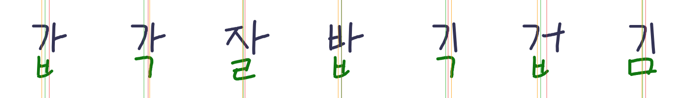
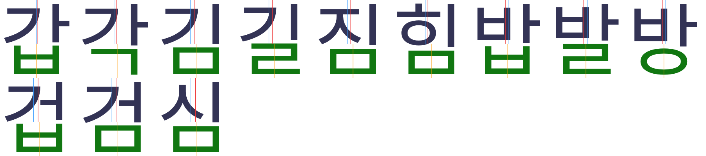
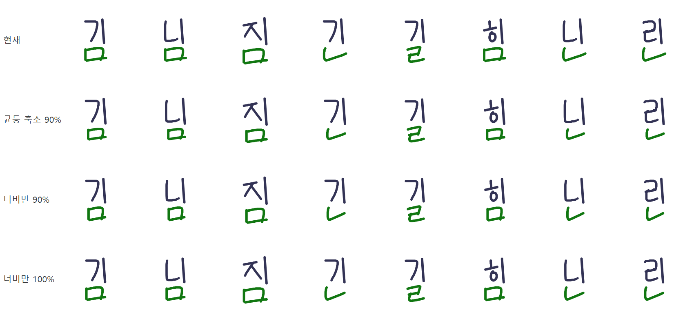
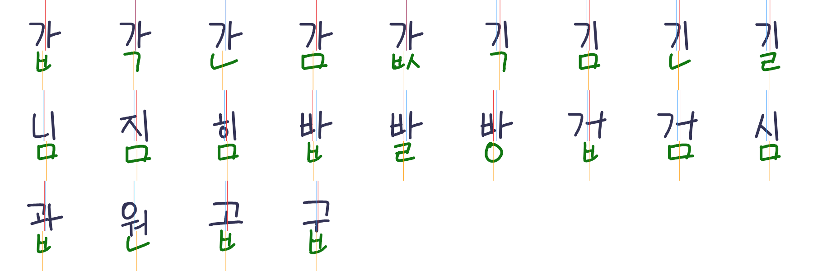

# 받침의 시각적 가운데 정렬

대상 코드: `finalTargetX`, `finalAnchorX` (`src/font/layout/syllable-layout.ts`), `inkBalance` (`src/font/geometry/optical.ts`), `stretchShapeWidth` (`src/font/geometry/shape.ts`), `learnGaps` (`src/generation/learning/gaps.ts`).

## 문제

- `갑`의 ㅂ, `김`의 ㅁ처럼 세로 모음 아래 받침이 가운데로 보이지 않음.
- 기존 규칙: 받침 상자 중심을 `초성 상자 중심 × 0.65 + 모음 기둥 중심 × 0.35`에 맞춤.

수정 전. 갑 각 잘 밥 긱 겁 김. 빨강 = 윗몸 잉크 평균, 초록 = 받침 상자 중심, 주황 = 받침 잉크 중심. `갑`·`밥`·`겁`의 ㅂ 몸통이 초록 선보다 왼쪽에 있음.

## 원인

1. **받침 자체가 비대칭.** 손글씨 ㅂ은 가운데 가로획이, ㅁ은 아래 가로획이 오른쪽으로 삐져나옴. 상자 중심을 맞추면 몸통은 왼쪽으로 감 (`갑`의 ㅂ에서 33 단위).
2. **기준이 틀렸음.** 받침은 윗몸의 중심이 아니라 모음 기둥의 오른쪽 변에 대해 놓임. 윗몸 상자 중심이나 잉크 평균은 곁줄기 유무에 따라 답이 달라짐.
3. **넓은 받침이 윗몸보다 넓었음.** 너비 제한(85%)을 초성·모음이 자리 잡기 전에 재서 ㅣ 아래에서는 걸리지 않았음. 움직일 여유가 없어 위치 규칙이 무시됨.
4. **학습 오프셋의 기준 불일치.** `crossOffset`은 윗몸 상자 중심 기준으로 재고, 적용은 다른 기준점에 했음.

## 근거: Noto Sans KR 실측

글자를 픽셀로 칠해 받침 중심의 위치를 잼 (`tools/archive/final-stem-fit.mjs`, `tools/archive/final-rule-fit.mjs`, 로컬 전용). 기둥 있는 모음(세로·복합) 500여 자 기준.

| 기준 | 받침 중심의 위치 |
|---|---|
| 윗몸 상자 중심 | +7.6% ± 4.5 (ㅏㅑ −1%, ㅓㅕㅣㅐㅔ +10%) |
| 윗몸 잉크 평균 | ㅏ +1%, ㅣ +7% |
| **윗몸 왼쪽 끝 ~ 기둥 오른쪽 끝** | **60% 지점 ± 1.7** |

- 마지막 기준은 ㅏㅑ 60.7%, ㅓㅕㅣㅐㅔ 59.7%, 복합 모음 60.4%로 모음 종류와 무관함.
- 굵기와도 무관함: Thin 60.4%, Regular 60.1%, Black 59.7%.
- 가로 모음은 윗몸 상자 중심 ± 1.4~1.9.

같은 글자의 Noto Sans KR. 위 파랑 = 윗몸 상자 중심, 위 빨강 = 윗몸 잉크 평균, 아래 주황 = 받침 중심. ㅣ·ㅓ 계열은 받침이 파랑보다 뚜렷이 오른쪽, ㅏ 계열은 파랑 근처임. 둘 다 기둥 기준으로는 같은 자리.

이 기준으로 그동안의 판단이 모두 설명됨.

| | 구간 안 위치 | 본 느낌 |
|---|---|---|
| `갑` 원래 | 41% | 왼쪽 |
| `갑` 첫 수정 | 64% | 좋음 |
| `갑` 잉크 평균 + 3% | 78% | 과함 |
| `김` 원래 | 48% | 왼쪽 |
| `김` 중간 수정 | 54% | 아직 왼쪽 |

## 결정

1. **목표점은 규칙 하나.** 오른쪽에 기둥이 있는 모음은 `윗몸 왼쪽 끝 + (기둥 오른쪽 끝 − 윗몸 왼쪽 끝) × 0.6` (`STEM_SHARE`). 기둥이 없는 모음은 윗몸 상자 중심. 모음 계열별 분기 없음.
2. **받침의 기준점은 잉크 중심.** 잉크의 가운데 80%가 차지하는 구간의 중심을 목표점에 맞춤. 상자 중심에서 너비의 25%까지만 벗어남 (`ANCHOR_REACH`).
3. **넓은 받침은 너비만 줄임.** 자리 잡은 윗몸 너비의 90%를 넘으면 높이는 두고 너비만 줄임. 펜 굵기는 유지됨.
4. **몸통 밖 제한은 잉크 대부분에만.** 가운데 80% 구간은 윗몸 양쪽으로 5%까지 (`FINAL_OVERHANG`). 가는 획 끝은 더 나갈 수 있음.
5. **필체 반영은 학습값으로.** `crossOffset`을 위 목표점에 대한 잔차로 재고, 윗몸 너비의 6%까지만 더함 (`CROSS_OFFSET_REACH`).
6. **잉크는 래스터 없이 셈.** 펜 중심선 길이 × 펜 굵기. 레이아웃이 canvas 없이 음절당 여러 번 돌기 때문.

3번의 근거. 김 님 짐 긴 길 힘 닌 린을 현재 / 균등 축소 90% / 너비만 90% / 너비만 100%로 비교. 균등 축소는 받침이 작아 보여 부자연스러움. 너비만 90%를 채택함.

## 버린 안

- **가우시안 블러 + alpha mask**: 레이아웃 경로에 canvas가 없고 비용이 큼. 중심선 기반으로 대체.
- **가중 median을 받침 기준점으로**: ㄱ 받침을 너무 크게 밂. 가운데 80% 구간의 중심으로 대체.
- **[초성 왼쪽, 기둥 오른쪽]의 50% 지점**: 원래 규칙보다 더 왼쪽이 됨.
- **구조 기준과 윗몸 잉크 평균을 0.5씩 혼합**: `갑`은 좋았으나 `김`은 왼쪽으로 남음.
- **윗몸 잉크 평균 + 3%**: `갑`이 과하게 오른쪽으로 감. 이 필체의 `기`는 잉크가 Noto보다 오른쪽에 몰려 있어 필체에 따라 결과가 흔들림.
- **넓은 받침을 윗몸 상자 중심 쪽으로 옮기는 보정과 그 예외**: 계열별 특이 처리라 제거.
- **균등 축소로 너비 제한**: 받침이 작아 보임.

## 결과

수정 후. 갑 각 간 감 값 긱 김 긴 길 / 님 짐 힘 밥 발 방 겁 검 심 / 괍 원 곱 굽. 선의 뜻은 Noto 시트와 같음.

- `갑`: ㅂ 상자 373–539 → 402–568.
- `김`: ㅁ 상자 356–644 → 407–646, 구간 안 48% → 60%. 꼬리가 ㅣ 오른쪽으로 27 나옴.
- 복합 모음(`괍`, `원`)도 같은 규칙을 따름.
- 가로 모음(`곱`, `굽`)은 받침의 잉크 중심이 윗몸 상자 중심에 옴.

## 남은 것

- 전체 11,172자 검사와 앱 화면 확인은 하지 않음. 14~22자 시트로만 확인함.
- 이 필체의 ㅏ는 곁줄기가 길어 `간`·`감`·`값`의 받침이 곁줄기 아래를 덜 채움. 어색하면 `STEM_SHARE` 하나만 조정하면 전체가 같이 움직임.
- fixture에 받침까지 직접 쓴 음절이 5자뿐이라 학습 오프셋의 효과는 검증하지 못함.
