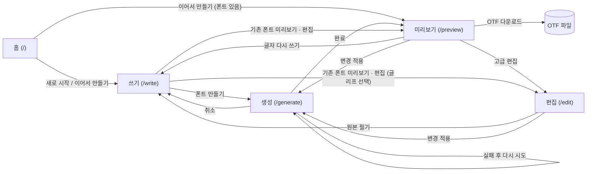

# Use Case

이 문서는 OwnChar의 구현을 기준으로 작성했습니다. 사용자가 기능을 사용하는 순서와 각 단계에서 일어나는 효과를 설명합니다.

대상 코드는 `src/routes`, `src/features`, `src/project`, `src/generation`입니다.

## 액터와 전제

- **사용자**: 펜, 마우스 또는 터치로 글씨를 쓰는 사람입니다. 계정과 로그인은 없습니다.
- **시스템**: 브라우저에서 동작하는 OwnChar입니다. 서버로 데이터를 전송하지 않습니다.
- 시스템은 필기, 설정, 생성된 폰트를 브라우저의 IndexedDB에 저장합니다.
- 휴대폰 크기의 화면에서는 "더 넓은 화면이 필요해요" 안내만 표시됩니다. 태블릿 또는 데스크톱을 사용하십시오.

## 전체 흐름

## 목록

| ID | Use Case | 화면 |
|----|----------|------|
| [UC-01](UC-01-start-or-resume.md) | 새 프로젝트를 시작하거나 이어서 만든다 | `/` |
| [UC-02](UC-02-write-sentence.md) | 문장을 쓰면서 자모를 수집한다 | `/write` |
| [UC-03](UC-03-manual-jamo-boundary.md) | 자모 경계를 직접 지정한다 | `/write` |
| [UC-04](UC-04-navigate-and-rewrite.md) | 문장을 이동하고 다시 쓴다 | `/write` |
| [UC-05](UC-05-generate-font.md) | 폰트를 생성한다 | `/write`, `/generate` |
| [UC-06](UC-06-preview-and-download.md) | 결과를 확인하고 OTF 파일을 내려받는다 | `/preview` |
| [UC-07](UC-07-edit-glyphs.md) | 글리프를 개별로 보정한다 | `/edit` |
| [UC-08](UC-08-tune-composition.md) | 한글 조합 설정을 조정한다 | `/edit` |
| [UC-09](UC-09-apply-changes.md) | 변경을 적용하여 폰트를 다시 생성한다 | `/preview`, `/edit` |
| [UC-10](UC-10-autosave-and-help.md) | 자동 저장과 도움말을 사용한다 | 전체 |

## 페이지 사양

Use Case를 만족하기 위한 최소 페이지 사양입니다. 사양은 페이지의 기능과 조작 요소만 정의합니다. 시각 디자인은 정의하지 않습니다.

| ID | 페이지 | 경로 | 대응 Use Case |
|----|--------|------|---------------|
| [PG-01](PG-01-home.md) | 홈 | `/` | UC-01 |
| [PG-02](PG-02-write.md) | 쓰기 | `/write` | UC-02, UC-03, UC-04, UC-05, UC-10 |
| [PG-03](PG-03-generate.md) | 생성 | `/generate` | UC-05, UC-09 |
| [PG-04](PG-04-preview.md) | 미리보기 | `/preview` | UC-06, UC-09 |
| [PG-05](PG-05-glyph-editor.md) | 글리프 편집 | `/edit` | UC-07, UC-09 |
| [PG-06](PG-06-composition-settings.md) | 조합 설정 | `/edit` | UC-08, UC-09 |
| [PG-07](PG-07-help.md) | 도움말 | `/license` | UC-10 |
| [PG-08](PG-08-common-layout.md) | 공통 레이아웃 | 전체 | UC-01, UC-10 |

## 용어

| 용어 | 뜻 |
|------|----|
| 수집 | 칸에 쓴 획을 초성, 중성, 종성으로 나누어 저장하는 일 |
| 문맥형 | 음절 안의 배치에 따라 모양이 다른 자모. 예: `가`의 ㄱ과 `각`의 ㄱ |
| 고정 자모 | 이미 수집한 자모. 칸에 회색 가이드로 표시됩니다 |
| 보정값 | 고급 편집에서 글자마다 지정하는 여백, 높이, 크기, 회전 값 |
| 변경 적용 | 현재 필기와 설정으로 폰트를 다시 생성하는 일 |

문맥형 자모는 초성 8벌, 중성 2벌, 종성 1벌입니다. 자주 쓰는 형태만 필수입니다.
